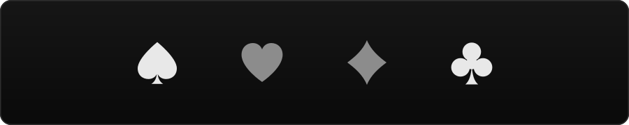

[README (6).md](https://github.com/user-attachments/files/35279080/README.6.md)

 

---

## Sobre mim

Olá! Eu sou o **Wendell Cavalcante**, estudante de **Engenharia de Software** em Brasília - DF e apaixonado por tecnologia.

Estou construindo minha base como desenvolvedor, criando projetos e aprendendo um pouco mais a cada commit.

- 🎓 Estudante de Engenharia de Software
- 📍 Brasília - DF, Brasil
- 🔭 Foco atual: desenvolvimento web e lógica de programação

## Contato

[Instagram](https://www.instagram.com/wnd_ll/) · [GitHub](https://github.com/WendellCavalcante)
